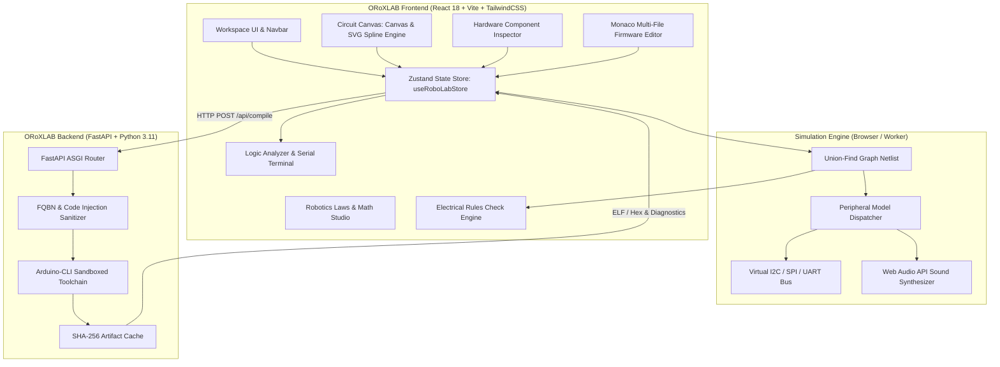

# ORoXLAB — Virtual Robotics & Embedded Systems Studio

<div align="center">


### *Next-Generation Browser-Based Embedded Systems & Robotics Laboratory*

[](https://github.com/Safin313-REBORN/ORoXLAB)
[](https://www.typescriptlang.org/)
[](https://react.dev/)
[](https://vitejs.dev/)
[](https://fastapi.tiangolo.com/)
[](https://www.python.org/)
[](LICENSE)

[**Explore Live Demo**](http://127.0.0.1:5173) • [**Quickstart**](#-quick-start) • [**Component Catalog**](#-hardware-component-catalog) • [**Laws & Math Studio**](#-robotics-and-electrical-laws-studio) • [**Deployment**](#-deployment-guide)

</div>

---

## 🌟 Overview

**ORoXLAB** is a full-stack, browser-based embedded engineering workbench and virtual robotics simulator. It enables makers, roboticists, students, and firmware engineers to design complex microcontroller circuits, simulate realistic sensors and actuators with real physical behaviors, write Arduino/ESP-IDF C++ firmware, and verify electronic netlists—all inside a modern, claymorphic web experience.

Whether you are modeling an autonomous two-wheel line-follower robot, tuning a closed-loop PID velocity controller, testing a TP4056 battery management system with 600mAh LiPo cells, or rendering telemetry to a 1.3" IPS full-color display, ORoXLAB delivers authentic hardware simulation right in the browser.

---

## ✨ Key Features

- 🎨 **Claymorphic Glassmorphism UI**: High-contrast, tactile design system with ambient glow, recessed via sockets, specular reflections, and responsive layouts across mobile, tablet, and desktop viewports.
- ⚡ **24+ Industrial Components**: Authentic microcontrollers, motor drivers, optical sensors, IMUs, OLED and IPS screens, LiPo battery packs, and audio synthesizers with realistic dimensions and pin assignments.
- 🧬 **Physics-Based Spline Wire Routing**: Cubic Bezier wire trajectories with realistic gravitational droop, silver/gold metallic eyelets, and non-clipping vector offsets.
- 📐 **Robotics & Electrical Laws Studio**: Interactive equation solvers for Ohm's Law, Joule Heating, Voltage Dividers, RC Timing Filters, Motor Back-EMF & Torque, PID Closed-Loop Tuning, and Nyquist Sampling.
- 💻 **Monaco Multi-File Firmware Editor**: Desktop-class C++ IDE with syntax highlighting, autocomplete, multi-tab navigation, and live code compilation.
- 🔬 **Real-Time Instrumentation**: 8-Channel Digital Logic Analyzer, Virtual Serial Terminal, Live GPIO Pin State Monitors (0V / 3.3V), and automated Electrical Rules Check (ERC).
- 🔋 **Power & Thermal Simulation**: Real CC/CV battery charging profiles, DW01A protection cutoffs, current draw telemetry, and forward diode drops.
- 🚀 **11 Verified Starter Projects**: Instant 1-click loading for complete robot rovers, line followers, environmental stations, smart wearables, and PID testbenches.

---

## 📸 Studio Gallery

### 1. Interactive Circuit Canvas & Precision Spline Routing

*Realistic 5mm RGB LED, 1.3" IPS display, TP4056 Type-C charger, 600mAh LiPo pouch cell, and SW-420 vibration sensor wired to DOIT ESP32 DevKit V1.*

### 2. Component Inspector & Interactive Controls

*Live interactive controls for battery state of charge, USB plug-in state, trimmer potentiometer sensitivity, and real-time pin telemetry.*

### 3. Component Library Drawer (Power & Displays)

*Quick-search hardware catalog categorized by Power, Displays, Sensors, Motors, Inputs, and Passives.*

---

## 🧰 Hardware Component Catalog

ORoXLAB ships with **24+ precision hardware component models**, each rendered with real-world physical packaging and calibrated electrical properties:

| Component | Category | Physical Dimensions | Pin Count & Signals | Key Features & Interactive Model |
| :--- | :--- | :--- | :--- | :--- |
| **DOIT ESP32 DevKit V1** | Microcontrollers | 180×110 mm | 30 Pins (GPIO, ADC, DAC, Touch, I2C, SPI) | Dual-Core Xtensa LX6 @ 240MHz, onboard blue status LED, Boot/EN switches. |
| **TP4056 USB-C Charger** | Power | 140×90 mm | 6 Pins (`IN+`, `IN-`, `OUT+`, `B+`, `B-`, `OUT-`) | 1A CC/CV LiPo charger, Type-C USB port, dual `CHG` & `STDBY` LEDs, DW01A protection. |
| **3.7V 600mAh LiPo Battery** | Power | 130×80 mm | 2 Pins (`+`, `-`) | 603035 pouch cell, vacuum foil reflection, Kapton tape collar, dynamic voltage curve (3.0V–4.2V). |
| **1.3" IPS 240×240 RGB Display** | Displays | 140×115 mm | 8 Pins (`GND`, `VCC`, `SCL`, `SDA`, `RES`, `DC`, `CS`, `BLK`) | ST7789 SPI controller, 65K color TFT, curved glass sheen, Radar HUD & Telemetry demos. |
| **SSD1306 0.96" OLED** | Displays | 150×100 mm | 4 Pins (`GND`, `VCC`, `SCL`, `SDA`) | 128×64 monochrome OLED, I2C communication (`0x3C`), 1024-byte framebuffer. |
| **SW-420 Vibration Sensor** | Sensors | 120×75 mm | 3 Pins (`VCC`, `GND`, `DO`) | Gold spring tube switch, LM393 comparator, sensitivity potentiometer trimmer, `DO` indicator. |
| **5mm 4-Pin Diffuse RGB LED** | Passives | 70×82 mm | 4 Pins (`R`, `Cathode (-)`, `G`, `B`) | Frosted epoxy dome with specular diffusion, internal semiconductor dice, full hex color mixer. |
| **L298N Dual Motor Driver** | Robotics / Motors | 160×130 mm | 10 Pins (`VCC`, `GND`, `5V`, `OUT1-4`, `IN1-4`) | Dual full H-Bridge driver with aluminum heatsink, 5V regulator jumper, up to 2A per channel. |
| **TT DC Gearbox Motor** | Robotics / Motors | 140×75 mm | 2 Pins (`+`, `-`) | 1:48 gear reduction box, yellow housing, bi-directional rotation with live RPM and torque calculation. |
| **SG90 Micro Servo (9g)** | Robotics / Motors | 130×80 mm | 3 Pins (`GND`, `VCC`, `PWM`) | 50Hz PWM angle control (0°–180°), blue translucent nylon casing, animated horn. |
| **28BYJ-48 Stepper Motor** | Robotics / Motors | 150×90 mm | 5 Pins (`IN1-4`, `COM`) | 5V 4-phase unipolar stepper motor, step counter, precision angle resolver. |
| **MPU-6050 6-Axis IMU** | Sensors | 140×95 mm | 8 Pins (`VCC`, `GND`, `SCL`, `SDA`, `XDA`, `XCL`, `AD0`, `INT`) | 3-axis accelerometer ($\pm 2g$) & 3-axis gyroscope ($\pm 250^\circ/\text{s}$), Pitch/Roll orientation dials. |
| **HC-SR04 Ultrasonic Sensor** | Sensors | 145×80 mm | 4 Pins (`VCC`, `TRIG`, `ECHO`, `GND`) | Dual 40kHz transducer barrels, obstacle range slider (2cm–400cm), time-of-flight echo return. |
| **MQ-2 Gas / Smoke Sensor** | Sensors | 130×85 mm | 4 Pins (`VCC`, `GND`, `DO`, `AO`) | Steel mesh chamber, SnO2 sensor element, concentration slider (20–800 PPM), analog & digital trigger. |
| **PIR Motion Sensor (HC-SR501)**| Sensors | 125×80 mm | 3 Pins (`VCC`, `OUT`, `GND`) | White Fresnel dome lens, human motion simulation trigger with configurable trigger delay. |
| **TCRT5000 IR Line Tracker** | Sensors | 120×70 mm | 4 Pins (`VCC`, `GND`, `DO`, `AO`) | Infrared emitter & phototransistor pair, surface reflector toggle (White floor vs Black line). |
| **Photoresistor (LDR)** | Sensors | 100×65 mm | 3 Pins (`VCC`, `GND`, `AO`) | Cadmium-sulfide serpentine photocell, ambient illumination slider (0–1000 Lux), day/night threshold. |
| **MAX98357A I2S DAC Amp** | Audio | 135×80 mm | 5 Pins (`LRC`, `BCLK`, `DIN`, `VIN`, `GND`) | 3.2W Class-D mono audio amplifier with Web Audio API synthesis and animated VU meter. |
| **Active Buzzer** | Audio | 80×80 mm | 2 Pins (`+`, `-`) | 2.3kHz fixed audio transducer with acoustic pressure ripple animation. |
| **Tactile Push Button** | Inputs | 70×70 mm | 2 Pins (`1`, `2`) | Momentary tactile switch with metallic corner tabs and debounce modeling. |
| **TTP223 Capacitive Touch** | Inputs | 100×70 mm | 3 Pins (`VCC`, `GND`, `SIG`) | Touch detection PCB pad with animated fingertip contact glow. |
| **Rotary Encoder (EC11)** | Inputs | 110×85 mm | 5 Pins (`CLK`, `DT`, `SW`, `+`, `GND`) | Quadrature A/B encoder with integrated tactile push switch and position readout. |
| **5V Relay Module** | Power | 130×85 mm | 6 Pins (`VCC`, `GND`, `IN`, `NO`, `COM`, `NC`) | 10A electromechanical switching relay with flyback diode protection and status LED. |
| **Carbon Film Resistor** | Passives | 90×40 mm | 2 Pins (`T1`, `T2`) | 4-band color-coded resistor with selectable resistance ($100\,\Omega$ to $10\,\text{k}\Omega$). |

---

## 📐 Robotics and Electrical Laws Studio

ORoXLAB includes a dedicated **Engineering Formulas & Mathematical Physics Studio** accessible via the top navigation bar or bottom panel. It provides real-time interactive parameter computation and visualization:

```
┌────────────────────────────────────────────────────────────────────────┐
│                   ORoXLAB Mathematical Laws Engine                    │
├────────────────────────────┬───────────────────────────────────────────┤
│ 1. Ohm's Law               │  V = I × R                                │
│ 2. Joule Heating           │  P = V × I = I² × R                       │
│ 3. Voltage Divider Rule    │  V_out = V_in × [ R₂ / (R₁ + R₂) ]        │
│ 4. RC Low-Pass Filter      │  f_c = 1 / (2 × π × R × C)                │
│ 5. DC Motor Dynamics       │  T = K_t × I,   E_b = K_e × ω             │
│ 6. Closed-Loop PID Control │  u(t) = K_p·e(t) + K_i∫e(τ)dτ + K_d·de/dt │
│ 7. Nyquist-Shannon Theorem │  f_sample ≥ 2 × f_signal                  │
└────────────────────────────┴───────────────────────────────────────────┘
```

Each equation features interactive parameter dials, instant unit conversions, step-by-step theoretical proofs, and circuit design heuristics.

---

## 🏛️ System Architecture



---

## 🚀 Quick Start

### Prerequisites
- **Node.js**: v18.0.0 or higher
- **npm**: v9.0.0 or higher
- **Python**: v3.11 or higher
- *(Optional)* **Docker & Docker Compose** for containerized execution.

### Local Development Setup

1. **Clone the repository**:
   ```bash
   git clone git@github.com:Safin313-REBORN/ORoXLAB.git
   cd ORoXLAB
   ```

2. **Run Automated Preflight & Test Suite**:
   ```bash
   chmod +x deploy.sh
   ./deploy.sh
   ```

3. **Start the Backend Service**:
   ```bash
   cd backend
   python3 -m venv venv
   source venv/bin/activate
   pip install -r requirements.txt
   uvicorn app.main:app --host 0.0.0.0 --port 8000 --reload
   ```
   *Backend will be accessible at `http://127.0.0.1:8000` (Swagger UI at `/docs`).*

4. **Start the Frontend Studio**:
   ```bash
   cd ../frontend
   npm install
   npm run dev
   ```
   *Frontend Studio will launch at `http://127.0.0.1:5173`.*

---

## 🐳 Deployment Guide

### Option 1: Docker Compose (Recommended)

Run the full stack (Frontend + Backend + Reverse Proxy) with a single command:

```bash
docker compose up --build -d
```

- **Frontend**: `http://localhost` (Port 80)
- **Backend API**: `http://localhost:8000`
- **Health Check**: `curl -f http://localhost:8000/api/health`

To stop the containers:
```bash
docker compose down
```

### Option 2: Cloud Deployment (Vercel + Render / Cloud Run)

#### Frontend (Vercel / Netlify)
The repository includes pre-configured [`frontend/vercel.json`](frontend/vercel.json) and [`frontend/netlify.toml`](frontend/netlify.toml) files.

1. Connect your GitHub repository to Vercel or Netlify.
2. Set Root Directory to `frontend`.
3. Build Command: `npm run build`
4. Output Directory: `dist`
5. Configure environment variable: `VITE_API_BASE_URL=https://your-backend-api.onrender.com/api`

#### Backend (Render / Fly.io / GCP Cloud Run)
1. Point your platform to `backend/Dockerfile` or `backend/requirements.txt`.
2. Start Command: `uvicorn app.main:app --host 0.0.0.0 --port $PORT`
3. Set environment variables:
   ```env
   PORT=8000
   ENVIRONMENT=production
   CORS_ORIGINS=https://your-frontend.vercel.app
   ```

---

## 🧪 Testing & Verification

ORoXLAB enforces rigorous test coverage across both frontend and backend architectures:

```bash
# Run all Frontend Tests (Vitest)
cd frontend && npm test -- --run

# Run all Backend Tests (Pytest)
cd ../backend && pytest -v
```

### Verification Matrix
- ✅ **Frontend (29 Tests)**:
  - Netlist connectivity graph & Union-Find calculations
  - Electrical Rules Check (short circuit detection, floating gate warnings, overvoltage)
  - 24 Component model geometry, pin coordinates, and exit normals
  - 11 Starter project topologies and firmware validity
- ✅ **Backend (6 Tests)**:
  - Root and `/api/health` heartbeat status
  - Board target definitions & FQBN mapping
  - Compilation pipeline with SHA-256 build caching
  - Syntax error diagnostic capture
  - FQBN command injection protection and input sanitization

---

## 📡 REST API Reference

The backend provides high-performance asynchronous endpoints:

| Endpoint | Method | Description | Request Body / Parameters |
| :--- | :--- | :--- | :--- |
| `/api/health` | `GET` | Health check and service status. | None |
| `/api/boards` | `GET` | Returns list of supported microcontroller targets. | None |
| `/api/compile` | `POST` | Compiles sketch files against target FQBN. | `{ "sketch": "...", "board": "esp32doit-devkit-v1", "libraries": [] }` |
| `/api/simulate`| `POST` | Deterministic simulation stepping interface. | `{ "firmware": "...", "components": [...] }` |

Interactive OpenAPI documentation is available live at `http://127.0.0.1:8000/docs`.

---

## 📄 License & Credits

Distributed under the **MIT License**. See [LICENSE](LICENSE) for details.

Developed with ❤️ by the **ORoXLAB Team** (`Safin313-REBORN`).
Special thanks to the open-source community, Espressif Systems, and the Wokwi/QEMU embedded initiatives for inspiration.
